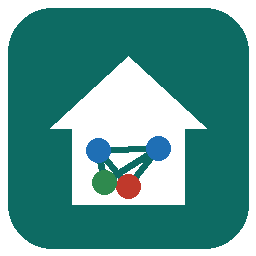

# home-map – Zigbee-Hausplan für Windows

Ein kleines Windows-Programm, das einen Hausplan mit allen Zigbee-Geräten zeigt: Grundrisse je Etage,
die Geräte an ihrem Einbauort, ihre Funkverbindungen aus der Netzwerkkarte von Zigbee2MQTT und – wenn
gewünscht – live, welche Geräte gerade online sind.



## Was es kann

- **Plan-Datei öffnen** (`*.zplan.json`, Strg+O oder per Ziehen ins Fenster). Die Datei enthält die
  Grundrisse (SVG), die Geräteliste, die Positionen, Netzwerkdosen, weitere Geräte (WLAN, LAN, …) und
  die zuletzt geladene Netzwerkkarte.
- **Ein- und ausblenden** je Geräteart über die Schalter über dem Plan: Zigbee, Zigbee-Verbindungen, WLAN,
  HomeMatic, X-Sense, DuoFern, andere Geräte (Zuordnung über `proto` der weiteren Geräte; `xsense` für X-Sense).
- **Bearbeiten**: Geräte platzieren und verschieben, Einbauhöhe wählen, Netzwerkdosen setzen.
  Änderungen werden automatisch in die geöffnete Datei gespeichert; beim ersten Speichern einer
  Sitzung bleibt der vorige Stand als `.bak` erhalten.
- **Netzwerkkarte laden**: die Rohdaten der Zigbee2MQTT-Netzwerkkarte (`bridge/response/networkmap`,
  Typ `raw`) als Datei – oder direkt live abrufen.
- **Live per MQTT**: Verbindung zum Broker von Zigbee2MQTT. Das Programm zeigt dann
  - offline gemeldete Geräte (rot durchgekreuzt),
  - die zuletzt gemeldete Empfangsqualität (LQI) je Gerät,
  - neue oder umbenannte Geräte (sie werden in die Plan-Datei übernommen),
  - auf Knopfdruck eine frische Netzwerkkarte (optional mit Routen).
- **Auffälligkeiten**: schwache Verbindungen trotz kurzer Entfernung, Geräte, die an einem weit
  entfernten Router hängen, obwohl ein näherer da wäre, usw.

## Starten

`home-map.exe` **und** `WebView2Loader.dll` (beide unter *Actions* bzw. *Releases*) in denselben Ordner legen und `home-map.exe` starten. Benötigt wird die
**Microsoft Edge WebView2 Runtime** – in Windows 11 und aktuellen Windows-10-Versionen ist sie bereits
enthalten. Eine Installation ist nicht nötig.

Einstellungen (zuletzt geöffnete Datei, MQTT-Zugang) liegen in `%APPDATA%\home-map\einstellungen.json`.
Das MQTT-Passwort liegt in der Windows-Anmeldeinformationsverwaltung (Eintrag `home-map/mqtt`).

Eine Plan-Datei kann auch als Argument übergeben werden (`home-map.exe Hausplan.zplan.json`), z. B. über
„Öffnen mit“.

## Plan-Datei

```jsonc
{
  "format": "zigbee-hausplan", "version": 1,
  "haus": {
    "massstab": {"S": 70, "OX": 600, "OY": 270, "TD": 9.37},   // px je m, Ursprung im SVG, Haustiefe
    "etagen": [{"id": "eg", "name": "EG", "svg": "eg", "z": 0}, …],
    "deckenhoehe": {"eg": 2.6, …},
    "zonen": [{"f": "eg", "x1": 0, "dz": -0.62, "name": "Anbau"}],  // abweichende Fußbodenhöhe
    "nord": 122                                                  // Himmelsrichtung von „oben“
  },
  "plans":   {"eg": "<svg …>", …},                 // Grundrisse je Etage
  "devices": [["0x…", "Name", "R"], …],             // C/R/E = Koordinator/Router/Batteriegerät
  "pos":     {"0x…": {"f": "eg", "x": 1.2, "y": 3.4, "hk": "mid"}},   // Meter, Höhe low/mid/ceil
  "lan":     {"id": {"f": "eg", "x": …, "y": …, "label": "…"}},
  "geraete": [{"name": "…", "proto": "wlan", "f": "eg", "x": …, "y": …, "z": …, "status": "aktiv"}],
  "zinfo":   {"Name": "Hinweis"},
  "net":     {"ts": …, "nodes": [[ieee, name, type, nwk]], "links": [[von, nach, lqi, beziehung, tiefe]]}
}
```

Koordinaten in Metern: `x` von der Giebelseite, `y` von der Straßenseite. Plan-Dateien gehören nicht in
dieses Repository (siehe `.gitignore`).

## Bauen

```sh
./build.sh            # erzeugt dist/home-map.exe (Go ≥ 1.26, kein cgo, geht auch unter Linux)
```

Aufbau:

| Datei | Inhalt |
|---|---|
| `app/ui/index.html` | die gesamte Oberfläche (HTML/CSS/JS), läuft auch im Browser – dann ohne Live-Verbindung |
| `app/main.go` | Fenster (WebView2), Bindungen für Dateien und MQTT |
| `app/live.go` | MQTT-Verbindung zu Zigbee2MQTT |
| `app/win.go`, `app/settings.go` | Datei-Dialoge, Einstellungen, DPAPI |
| `app/winres/` | Symbol, Manifest, Versionsinfo (`go-winres make` erzeugt die `.syso`) |
| `app/third_party/go-webview2/` | Kopie von go-webview2 (MIT); geändert: `WebView2Loader.dll` wird nur von der Platte geladen, nicht aus dem Speicher – das hatten Virenscanner als Trojaner gemeldet |

Verwendete Bibliotheken: [go-webview2](https://github.com/jchv/go-webview2),
[paho.mqtt.golang](https://github.com/eclipse/paho.mqtt.golang), golang.org/x/sys.
